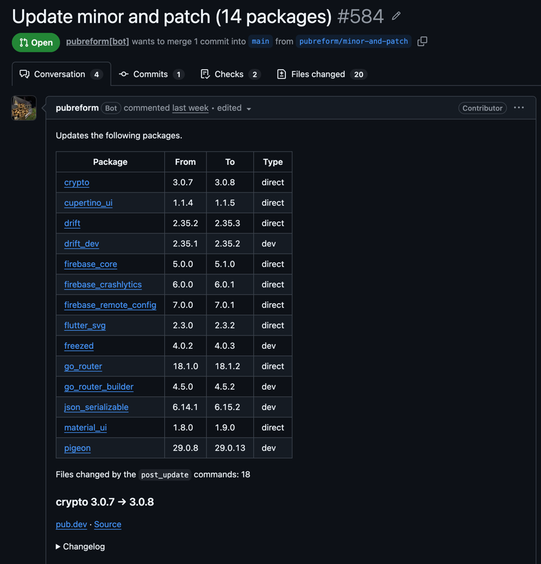

# pubreform

A Dependency bot made for Dart and Flutter projects.



## Why pubreform

Dependabot and Renovate can update pub dependencies too. pubreform is made only for pub, and adds the following:

- **The Flutter version you already use.** Dependencies are resolved with the Flutter SDK in `.fvmrc`, or the SDK your workflow sets up. There is no separate setting to keep in sync.
- **Major updates that need each other, in one pull request.** When a major update only resolves together with major updates of other packages, pubreform proposes them together right away, instead of one at a time across several merges.
- **Changes are reported on the pull request.** When a newer version changes what a pull request updates, the pull request is updated in place, and a comment lists what was changed.

## Limitations

- Minor and patch updates are grouped in one pull request. This cannot be configured.
- Only the repository root. Pub workspaces are not supported yet
- Only packages hosted on pub.dev
- No pre-release versions

## Setup

You need `pubspec.yaml` and a committed `pubspec.lock` at the repository root.

**1. Create a GitHub App** with these repository permissions, and install it on the repository:

- Contents: Read and write
- Pull requests: Read and write

Add its client ID as the variable `PUBREFORM_CLIENT_ID`, and a private key as the secret `PUBREFORM_PRIVATE_KEY`. An App is needed because CI does not run on pull requests created with `GITHUB_TOKEN` until someone approves it. Commits are made through the GitHub API as the App, so they are shown as Verified.

**2. Add the config** as `.github/pubreform.yaml`:

```yaml
# $schema: https://raw.githubusercontent.com/chika3742/pubreform/v1/pubreform.schema.json
schedule:
  cron: "0 9 * * 1"
  timezone: Asia/Tokyo
min_release_age_days: 3
labels: [dependencies]
```

> [!NOTE]
> **What is the difference between the cron in `pubreform.yaml` and the one in the workflow?**
>
> The cron in the workflow decides when pubreform runs. The cron in `pubreform.yaml` decides which releases it can use: only versions published at least `min_release_age_days` before the last time this cron fired. Until it fires again, every run gives the same result, whether it was started by the schedule, a push or a checkbox.
>
> This lets you run the workflow more often than you take in new releases. For example, you can run the workflow daily to get security fixes quickly, and still receive new releases once a week.
>
> The cron in `pubreform.yaml` is not a time window. Runs at other times still rebase pull requests, close outdated ones and open security fixes.

To regenerate code such as build_runner outputs in the pull requests, add [post-update commands](#post-update-commands).

**3. Add the workflow**, for example as `.github/workflows/pubreform.yml`:

```yaml
name: pubreform

on:
  schedule:
    - cron: "0 9 * * 1"
      timezone: Asia/Tokyo
  push:
    branches: [main]
    paths: [pubspec.yaml, pubspec.lock, .fvmrc, .github/pubreform.yaml]
  pull_request:
    types: [edited]
  workflow_dispatch:

jobs:
  pubreform:
    # On pull_request, run only for pubreform's pull requests, and not for its own edits.
    if: >-
      github.event_name != 'pull_request' ||
      (startsWith(github.head_ref, 'pubreform/') && github.event.sender.type != 'Bot')
    runs-on: ubuntu-latest
    concurrency: # Set at job level so a pending job isn't canceled when the job is skipped
      group: pubreform
      cancel-in-progress: false
    steps:
      - uses: actions/create-github-app-token@v3
        id: app-token
        with:
          client-id: ${{ vars.PUBREFORM_CLIENT_ID }}
          private-key: ${{ secrets.PUBREFORM_PRIVATE_KEY }}
      - uses: actions/checkout@v7
      - uses: chika3742/setup-fvm@v3 # For Dart only projects, use dart-lang/setup-dart@v1
      - uses: chika3742/pubreform@v1
        with:
          token: ${{ steps.app-token.outputs.token }}
```

The workflow decides when the action runs. This one runs it every Monday, after the dependency files or the config change, and when a pubreform pull request is edited (to pick up the [Rebase this PR](#updating-a-pull-request) checkbox). The action does the same thing whichever event starts it.

> [!WARNING]
>
> As with any other workflow, the runner minutes it uses count toward your GitHub Actions usage.

## Configuration

| Key | Default | Description |
|---|---|---|
| `schedule.cron` | (required) | Cron expression with 5 fields for waiting period. See the Note above for more information. |
| `schedule.timezone` | `UTC` | IANA time zone name for `schedule.cron` |
| `min_release_age_days` | `0` | Days a version must have been out before it is used |
| `labels` | `[]` | Labels added to the pull requests. Missing labels are created |
| `versioning` | `increase` | `increase` also raises the lower bounds in `pubspec.yaml` for minor and patch updates. `lockfile-only` changes only `pubspec.lock` for them, except for pinned versions, which are always rewritten |
| `ignore` | `[]` | Updates to skip. `{ name }` skips the package, `{ name, versions }` skips the versions in a constraint such as `">=3.0.0"` |
| `post_update` | `[]` | Commands to run before each pull request is committed, such as code generation. See [Post-update commands](#post-update-commands) |
| `post_update[].run` | (required) | The command, run with `sh -c` at the repository root |
| `post_update[].network` | `false` | Whether the command can use the network |
| `post_update[].env` | `[]` | Names of more environment variables to pass, with their values from the workflow. Names starting with `INPUT_` or `ACTIONS_` are not allowed. The values can reach the pull request, through files the command writes or through the output in an error comment, so take care with secrets |
| `flutter.enabled` | `true` | Whether to update the Flutter version pinned in `.fvmrc`. See [Flutter SDK updates](#flutter-sdk-updates) |
| `flutter.versioning` | the value of `versioning` | How the `sdk` and `flutter` constraints in `environment` are rewritten for the new Flutter. `increase` raises their lower bounds. `lockfile-only` rewrites them only when the new version does not fit |
| `flutter.reapply` | `on-change` | `on-change` does not install the new SDK again while the pull request is up to date with the default branch and the config. `always` updates it on every run |

The action has two inputs: `token` (required), and `config`, the path to the config file on the default branch (default `.github/pubreform.yaml`).

## Things to know

### Updating a pull request

Check "Rebase this PR" in the description to rebuild a pull request on the latest default branch. pubreform also does this by itself when the pull request conflicts, when `pubspec.yaml`, `pubspec.lock`, `.fvmrc` or the config change on the default branch, or when the update changes.

- If you push commits to a pubreform branch, pubreform stops updating that pull request and leaves a comment. Check the box to discard your commits
- A pull request you close without merging is not opened again for the same versions
- If an update fails, the error is posted to its pull request, and the job fails
- Branches are named `pubreform/...`. Transitive dependencies are updated in `pubspec.lock` as needed, but are not listed, except those that fix a security advisory

### Security advisories

pubreform reads the security advisories that pub.dev reports (from the GitHub Advisory Database) for every package locked in `pubspec.lock`, direct or transitive. When a locked version is affected, pubreform updates it to a version that is not:

- The pull request that fixes it is titled with `[Security] `, for example `[Security] Update archive from 3.3.7 to 3.3.8`, and its description starts with a table of the advisories. A fixed transitive dependency is listed in the table of packages as `transitive`
- The waiting period is skipped only for one version: the oldest stable version that is newer than the locked one and is not affected, retracted or covered by `ignore`. Its release date is shown in the table. The other versions, including the dependencies of that version, still wait. The affected versions of that package are not used
- A fix that fits the current constraints (with a pinned version read as a caret constraint) goes into the minor and patch pull request, even if no direct dependency changes. Otherwise it is a major update. A transitive dependency is fixed only when the packages that depend on it allow the fixed version
- To skip an advisory, list its ID (or one of its aliases, such as a CVE) in `ignored_advisories` in `pubspec.yaml`, as for `dart pub`. Versions that an `ignore` rule in the config covers are never used: the oldest fix that it does not cover is used instead. The feature itself cannot be turned off
- The job summary lists each affected package and whether a pull request fixes it
- If the advisories cannot be read from pub.dev, the run fails without changing anything

```yaml
# pubspec.yaml
ignored_advisories:
  - GHSA-xxxx-xxxx-xxxx
```

Advisories are published at any time, not on the schedule. To get the fix soon, run the workflow every day and keep `schedule.cron` weekly: on days without new advisories, nothing changes.

```yaml
on:
  schedule:
    - cron: "0 9 * * *"   # the workflow: every day
```

```yaml
# .github/pubreform.yaml
schedule:
  cron: "0 9 * * 1"       # new releases: once a week
```

### Flutter SDK updates

When `.fvmrc` pins a stable Flutter version, such as `"flutter": "3.47.7"`, pubreform also keeps a pull request that updates it to the latest stable release, titled `Update Flutter from 3.47.7 to 3.50.0` (branch `pubreform/flutter`):

- The release must have been out for `min_release_age_days`, as for packages. There is one pull request, to the latest stable release. Channels, forks, pre-releases and `flavors` are not updated, and nothing is done without `.fvmrc`
- It changes the version in `.fvmrc`, the version in `dart.flutterSdkPath` of `.vscode/settings.json`, the `sdk` and `flutter` constraints in `environment` (with the Dart bundled with the new Flutter for `sdk`), and `pubspec.lock`, resolved by the new SDK. Comments and formatting are kept. Versions written elsewhere, such as in workflows, are not changed
- Direct dependencies that must move for the new Flutter (for example, a `test` that the new `flutter_test` does not allow) are updated in the same pull request, and listed in its description. If it does not resolve even then, there is no pull request, and the reason is in the job summary; an open one is closed with the reason
- With `flutter.versioning: increase`, raising the lower bound of `sdk` also raises the language version, which can change the results of `dart format` and lints. Use `lockfile-only` to keep it
- The new SDK is installed with fvm whenever the update is applied, which takes time and disk space. With `flutter.reapply: on-change`, a run in which the default branch and the config did not change leaves the pull request as it is without installing it, so newer versions of the dependencies it raises, and new security advisories, are picked up only after such a change
- Post-update commands run with the new SDK
- To skip a version, close its pull request without merging: the next version gets a new one

### Post-update commands

When pubreform creates or rebuilds a pull request, it can first run commands on the updated project, and commit the files they change (except files ignored by `.gitignore`) together with `pubspec.yaml` and `pubspec.lock`:

```yaml
post_update:
  - run: dart run build_runner build
  - run: ./tool/generate_api.sh
    network: true
    env: [API_SPEC_URL]
```

- Linux runners only, such as `ubuntu-latest`, where the runner user can use `docker` and `/bin` links to `/usr/bin` (merged `/usr`). Nothing is pulled: pubreform builds a small image from the runner's own files
- The commands run code from your dependencies, so pubreform runs each one in a new container that has only a copy of the repository without `.git` (writable), and the runner's `/usr`, the SDK and the pub cache (read-only). It cannot see the tokens, the runner's processes or the other files of the runner, gets only a few environment variables (`PATH`, `HOME`, `PUB_CACHE`, `LANG`, `LC_ALL`, `CI`, `FLUTTER_ROOT`, and those in `env`), and has no network unless `network: true`. Dependencies are already fetched, so `dart run` works without the network. Do not run `dart pub get` in the commands: it fails, even with `network: true`, because the pub cache is read-only. Tools installed under your home directory are not available
- In Flutter projects (and projects with `.fvmrc`), `dart` is the Dart bundled with the Flutter SDK, so `dart run build_runner build` works, but `flutter` commands such as `flutter gen-l10n` do not: the `flutter` command writes to the SDK, which is read-only
- Bring the generated code on the default branch up to date first. Otherwise, the changes that are already due on the default branch show up in every pull request
- The commands run only when a pull request is created or rebuilt, once per pull request. Changing `post_update` rebuilds every pull request
- If a command fails, the pull request is not created, or is left as it is with the error posted to it, and the job fails

## License

[MIT](LICENSE)
